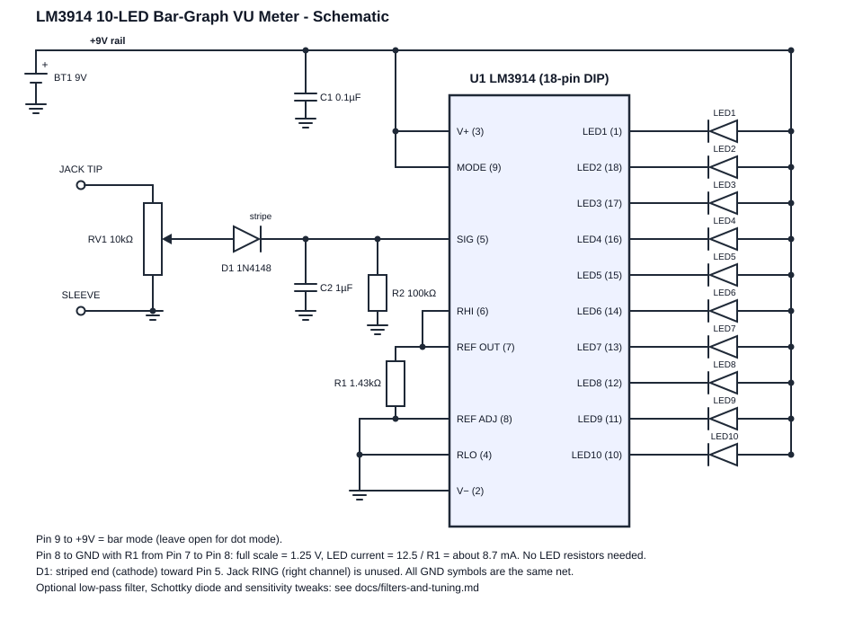

# LM3914 Analog VU Meter

A 10-LED bar-graph audio level meter built around the **LM3914** dot/bar display driver. Plug in a phone or laptop through a 3.5 mm jack and a bar of LEDs rises and falls with the music. There is no microcontroller, no soldering (it is built on a breadboard), and no per-LED resistors.

<p align="center">
  
</p>

<!-- Add a photo or GIF of your build: save it as docs/images/build.jpg, then replace this comment with:

-->

**Status:** breadboard prototype. How many LEDs light depends on the output level of your audio source. See [Sensitivity](#sensitivity-and-known-limitations).

## How it works

The audio goes through a volume pot and a diode, which keeps only the positive half of the waveform. A small capacitor and a bleed resistor turn that into a smooth "peak level" voltage on the chip's signal pin. Inside the LM3914, ten comparators compare that voltage against ten evenly spaced thresholds. Each comparator drives one LED, so the louder the music, the more LEDs light.

Read [docs/theory.md](docs/theory.md) for the full pin-by-pin explanation.

## Bill of materials

| Ref | Qty | Value | Purpose |
|-----|----:|-------|---------|
| U1 | 1 | LM3914N | Dot/bar display driver (18-pin DIP) |
| LED1-LED10 | 10 | 5 mm LED | Display |
| R1 | 1 | 1.43 kOhm | Sets LED current (1k + 330 + 100 ohm in series) |
| R2 | 1 | 100 kOhm | Bleed resistor on Pin 5 |
| RV1 | 1 | 10 kOhm pot | Input level |
| D1 | 1 | 1N4148 | Half-wave rectifier |
| C1 | 1 | 0.1 uF ceramic | Supply bypass |
| C2 | 1 | 1 uF | Peak smoothing on Pin 5 |
| J1 | 1 | 3.5 mm jack breakout | Audio input |
| BT1 | 1 | 9 V battery + clip | Power |
| - | 1 | Breadboard + jumper wires | |

The machine-readable list is in [BOM.csv](BOM.csv).

## Pin connections

| Pin | Name | Connect to |
|----:|------|------------|
| 1 | LED 1 | Cathode of LED 1 |
| 2 | V- | GND |
| 3 | V+ | +9 V |
| 4 | RLO | GND |
| 5 | SIG | D1 cathode, R2 and C2 to GND |
| 6 | RHI | Pin 7 |
| 7 | REF OUT | Pin 6 and one end of R1 |
| 8 | REF ADJ | Other end of R1 **and** GND |
| 9 | MODE | +9 V (bar mode) |
| 10 | LED 10 | Cathode of LED 10 |
| 11 | LED 9 | Cathode of LED 9 |
| 12 | LED 8 | Cathode of LED 8 |
| 13 | LED 7 | Cathode of LED 7 |
| 14 | LED 6 | Cathode of LED 6 |
| 15 | LED 5 | Cathode of LED 5 |
| 16 | LED 4 | Cathode of LED 4 |
| 17 | LED 3 | Cathode of LED 3 |
| 18 | LED 2 | Cathode of LED 2 |

> The LED pin order is not sequential: LED 2 is on Pin **18**, counting down to LED 10 on Pin **10**. This is the most common wiring mistake with this chip.

All LED anodes (long legs) go straight to +9 V. The LM3914 regulates the LED current itself.

## Build it

Follow the step-by-step instructions in [docs/build-guide.md](docs/build-guide.md). In short:

1. Power, ground, and mode pins (Pins 2, 3, 4, 9) and the 0.1 uF bypass capacitor.
2. Reference network: Pin 6 to Pin 7, R1 from Pin 7 to Pin 8, Pin 8 to GND.
3. Audio input: jack, pot, diode, then R2 and C2 on Pin 5.
4. The ten LEDs.

## Sensitivity and known limitations

- **Signal level.** Full scale is 1.25 V, the diode drops about 0.6 V, and a phone at full volume only gives roughly 1 to 1.4 V peak. Expect the lower and middle LEDs to light easily and the top ones only with a stronger signal. [docs/filters-and-tuning.md](docs/filters-and-tuning.md) explains how to improve this (Schottky or germanium diode, lower full scale, op-amp gain stage).
- **Linear scale.** The LM3914 steps are equal in volts. For a more natural audio feel use the LM3915 (3 dB per step) or LM3916 (VU scale). They have the same pinout.
- **Not a true VU meter.** The Pin 5 peak detector gives a quick-attack, 0.1 s decay display, not the standardized VU ballistics.
- **Mono.** Only the left channel (jack tip) is used.
- **Power.** With all 10 LEDs lit the circuit draws about 87 mA, so a 9 V battery will not last long. Use a wall adapter for long sessions.

## Optional upgrades

- Low-pass filter so the bar follows bass and kick drums ([docs/filters-and-tuning.md](docs/filters-and-tuning.md)).
- Schottky or germanium diode for more sensitivity.
- Lower full-scale voltage using one extra resistor.
- Op-amp gain stage before the diode.

## Calculator

`tools/vu_calc.py` works out the reference voltage, LED current, filter cutoff, and the signal level needed for each LED. It uses only the Python standard library.

```bash
python tools/vu_calc.py                         # the circuit as built above
python tools/vu_calc.py --diode 0.3             # with a Schottky diode
python tools/vu_calc.py --rhi-series 4700       # lower full scale
python tools/vu_calc.py --filter-r 2000         # add a 2k + 0.1 uF low-pass filter
```

The results are estimates from datasheet formulas, not measurements.

## Repository layout

```
.
├── README.md
├── LICENSE
├── BOM.csv
├── docs/
│   ├── schematic.svg
│   ├── build-guide.md
│   ├── theory.md
│   ├── filters-and-tuning.md
│   ├── troubleshooting.md
│   └── images/
└── tools/
    └── vu_calc.py
```

## References

- LM3914 datasheet: <https://www.ti.com/product/LM3914>

## License

Released under the [MIT License](LICENSE).
